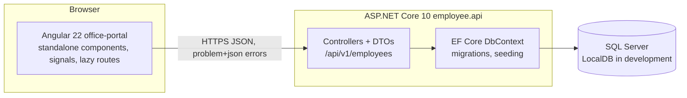

# Exodus Office

Employee management workspace for the Exodus home office, built as a full-stack portfolio project with Angular, ASP.NET Core, EF Core, and SQL Server.

The office is a development-stage team of five people and one client, so the data set is small. The project exists to practice and demonstrate each layer of a production-shaped web application, one roadmap phase at a time. See [docs/development-roadmap.md](docs/development-roadmap.md) for the phases and [docs/api/employees.md](docs/api/employees.md) for the API contract.

## Architecture



- **office-portal/**: Angular app. `core/` holds the workspace shell, API configuration, HTTP error handling, and the title strategy. `features/employees/` holds the employee page and API service. `shared/feedback/` holds the toast notifications.
- **server/employee.api/**: .NET API. `Data/` holds the DbContext, entities, migrations, and the development seeder. `Features/Employees/` holds the controller, contracts, and mapper. `employee.api.Tests/` holds xUnit tests.

## Local setup

Prerequisites: Node.js 22, .NET SDK 10, SQL Server LocalDB (ships with Visual Studio) or any SQL Server you can point a connection string at.

### API

```bash
cd server/employee.api
dotnet restore employee.api.slnx
dotnet run --project employee.api --launch-profile https
```

On first start in the Development environment the API applies migrations to the `ExodusOffice` database and seeds the five team members (controlled by `Seeding:Enabled` in `appsettings.Development.json`). OpenAPI JSON is served at `https://localhost:7269/openapi/v1.json`. Sample requests live in `employee.api/employee.api.http`.

To point at a different SQL Server without committing credentials, use user secrets:

```bash
cd server/employee.api/employee.api
dotnet user-secrets set "ConnectionStrings:ExodusOffice" "Server=...;Database=ExodusOffice;User Id=...;Password=...;TrustServerCertificate=True;"
```

Schema changes go through migrations:

```bash
dotnet ef migrations add <Name> --project employee.api -o Data/Migrations
dotnet ef database update --project employee.api
```

### Web

```bash
cd office-portal
npm ci
npm start
```

The app runs at `http://localhost:4200` and calls the API base URL from `src/environments/environment.development.ts`.

### Tests

```bash
cd office-portal && npx ng test --watch=false
cd server/employee.api && dotnet test employee.api.slnx
```

Both suites run on every pull request through GitHub Actions (`.github/workflows/ci.yml`).

## Phase log

| Phase | What shipped | Skills practiced |
|---|---|---|
| 0 Foundation | Routed workspace shell with lazy pages, environment-based API configuration, typed employee API service, HTTP error interceptor and toast feedback; versioned REST routes with DTOs, validation, problem details, async EF Core, migrations, development seeding, xUnit tests, and CI. | Angular routing and signals, ASP.NET Core API design, EF Core migrations, GitHub Actions. |

Later phases are described in the roadmap and will be added here as they ship.
